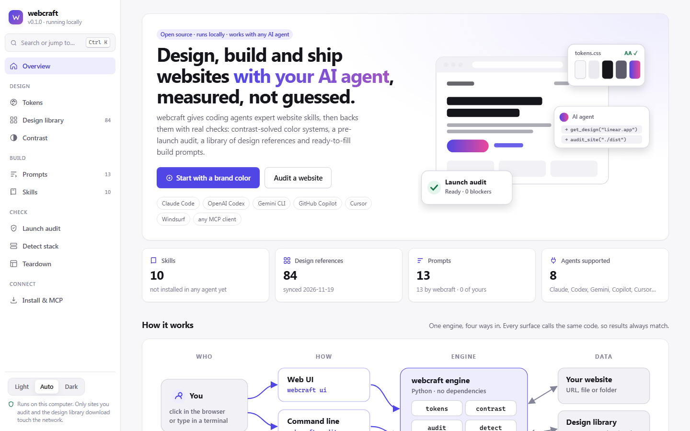
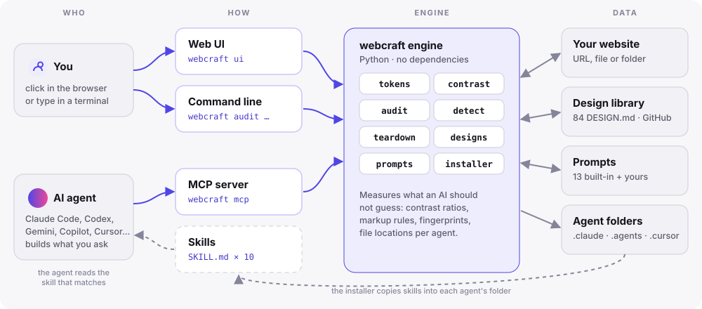
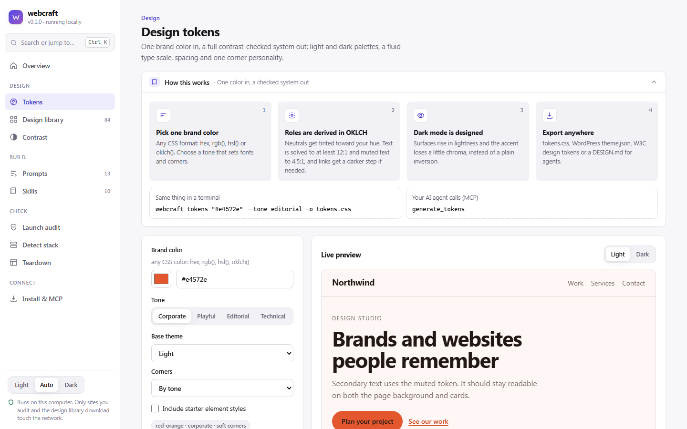
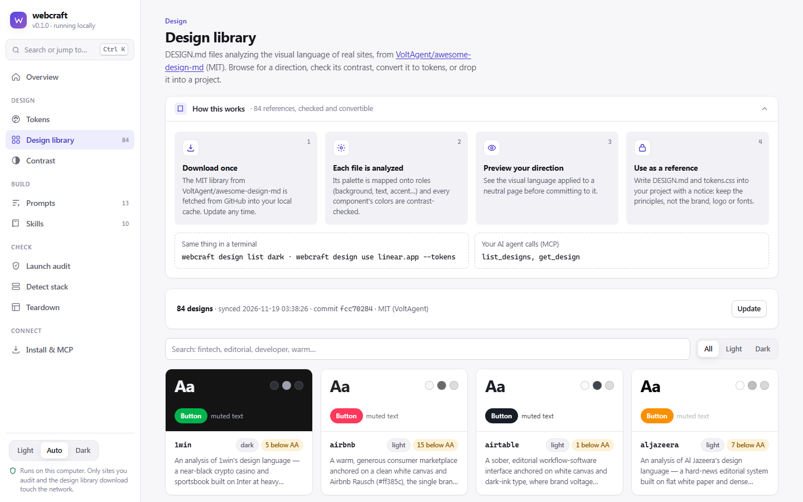
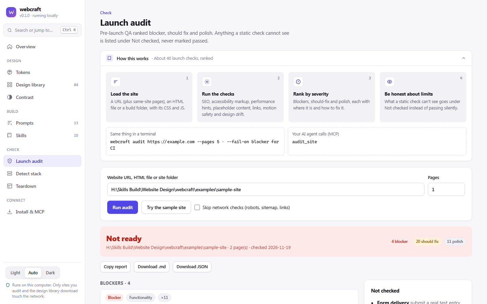
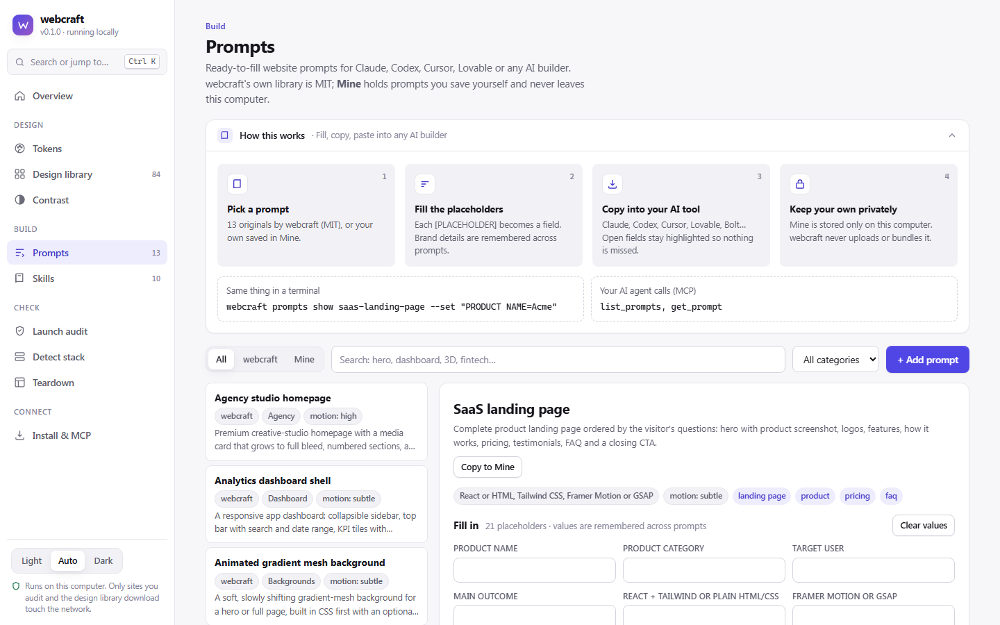
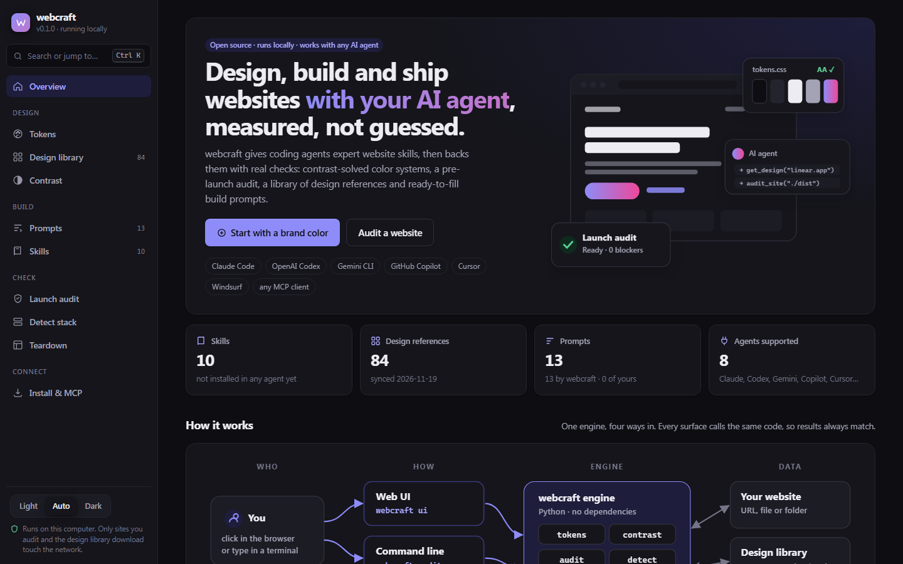

# webcraft

Website-design skills for AI coding agents, plus the checks those skills keep asking for.

webcraft packages ten skills (homepage structure, hero, responsive layout, scroll motion, design tokens, DESIGN.md, WordPress themes, launch QA, site teardown, and a workflow that sequences them) in the open [Agent Skills](https://agentskills.io) format. It adds a zero-dependency CLI, MCP server and local web UI that turn the measurable parts of those skills into commands:

- generate a contrast-checked token set from one brand color
- audit a site before launch
- fingerprint a site's stack
- draft a rebuild brief without copying anyone's content
- browse, check and convert a library of 84 DESIGN.md design-system references
- fill in ready-made website prompts, and keep a private library of your own

It works with Claude Code, OpenAI Codex, Gemini CLI, GitHub Copilot, Cursor, Windsurf, and anything that reads `AGENTS.md` or speaks MCP.



## How it works



webcraft has four parts. They share one engine, so a result is the same however you ask for it.

| Part | What it is | Who uses it |
|---|---|---|
| **Skills** | Ten instruction files (`SKILL.md`) for planning a homepage, building heroes, layouts and motion, picking colors, converting to WordPress, and running QA. Installed into each agent's folder. | Your AI agent, which reads a skill when your request matches its description |
| **Engine tools** | Deterministic Python for what an AI shouldn't guess: contrast math, about 40 launch checks, stack fingerprints, placeholder-only teardowns, and the file paths each agent uses. | Everyone, through the three surfaces below |
| **Libraries** | 84 DESIGN.md design references (downloaded on request, MIT), 13 original build prompts, and your private prompts. | You, when choosing a direction, and your agent, through MCP |
| **Surfaces** | `webcraft ui` (browser), `webcraft <command>` (terminal) and `webcraft mcp` (AI agents). | You, and your agent |

**An example.** You tell Claude Code *"Build a homepage for my bakery in a calm style like Linear, warm orange brand."*

1. The agent matches the request to the `homepage-blueprint` and `design-md` skills and reads them.
2. It calls `get_design linear.app`. It gets Linear's palette, type and spacing, plus a flag that one of Linear's own color pairs fails contrast, so that pair isn't copied.
3. It calls `generate_tokens` with your orange and gets a light and dark color system where every text pair passes WCAG AA.
4. It builds the page using your brand, keeping Linear's density and hairlines but not its name, logo or fonts.
5. Before saying it's done, it calls `audit_site` on the build, fixes any blockers, and tells you what still needs a human, such as real-device tests and form delivery.

Without the MCP server the same flow works by hand. Copy a prompt from the UI, paste it into your agent, then run `webcraft audit ./dist`.

```text
$ webcraft audit ./dist
# Launch QA: ./dist   Checked: 2026-11-19   Scope: static analysis of 2 page(s), linked local CSS/JS

Verdict: Not ready
(4 blocker(s), 20 should fix, 11 polish)

## Blockers
1. 11 link(s)/asset(s) point to files that do not exist — local files — Fix the paths or add the missing files
2. Placeholder or template content is visible — index.html — Replace with real content or remove
   e.g. lorem ipsum text: "Lorem ipsum"; dummy phone number: "555-010-9999"; example email address: "hello@example.com"
3. No viewport meta tag, so phones render the desktop layout zoomed out — index.html — Add <meta name="viewport" ...>
4. Page is set to noindex (often left over from staging) — index.html — Remove noindex before launch
...
## Not checked
- Form delivery — submit a real test entry and confirm it arrives in the right inbox, with spam protection
- Core Web Vitals (LCP, INP, CLS) on a throttled connection — run PageSpeed Insights or Lighthouse
...
```

## Why

Skills are good at judgment: which sections a homepage needs, what a hero should say, which animation fits. They're bad at arithmetic. "Body text must be 7:1 on the background" and "no image without width and height" are measurements, and an agent eyeballing them gets them wrong confidently. webcraft gives each skill a deterministic tool for the part that can be measured, and a "Not checked" list for the part that can't.

## Install

Requires Python 3.9 or newer. There are no dependencies.

```bash
pipx install git+https://github.com/imperfec-t/webcraft      # or: pip install git+https://github.com/imperfec-t/webcraft
webcraft install claude                                   # put the skills where your agent looks
webcraft mcp-config claude-code                           # optional: add the tools inside the agent
```

For live-site audits on machines whose Python can't verify some certificates (common on Windows), install with `pip install "webcraft-skills[tls] @ git+https://github.com/imperfec-t/webcraft"` to use the operating system's trust store.

Prefer a visual interface? Run `webcraft ui`. It opens a local web app in your browser:

- **Overview:** live status, the how-it-works diagram, a project timeline, and where your files are stored.
- **A page for each tool:** tokens with a live preview, the design library, prompts, contrast, launch audit, stack detection, teardown, skills, and install and MCP setup.
- **A "How this works" panel on every page:** the steps, plus the equivalent terminal command and MCP tool.
- **Keyboard:** Ctrl/Cmd+K opens a command palette and `/` focuses the page's search.
- **Layout:** light and dark themes, and a mobile layout.

The UI binds to 127.0.0.1 only, and every API call needs a secret generated at each launch. Pass `--port` to choose a port and `--no-open` to skip opening the browser.

| Tokens with live preview | Design library |
|---|---|
|  |  |
| **Launch audit** | **Prompts** |
|  |  |

The dark theme follows your system setting or the switch in the sidebar:



No Python? The skills are plain folders. Copy `skills/*` into your agent's skills folder, or run `./install.sh claude` / `.\install.ps1 claude`. You lose the CLI checks, and each skill still works without them.

## Agent support

| Agent | `webcraft install …` | Where it goes | How the agent uses it |
|---|---|---|---|
| Claude Code | `claude` | `~/.claude/skills` (or `.claude/skills` with `--scope project`) | Native skills |
| OpenAI Codex | `codex` | `~/.agents/skills` / `.agents/skills` | Native skills |
| Gemini CLI | `gemini` | `~/.gemini/skills` / `.gemini/skills` | Native skills |
| GitHub Copilot | `copilot` | `~/.copilot/skills` / `.github/skills` | Native skills (CLI, cloud agent, VS Code agent mode) |
| OpenCode, Amp, Goose, others | `agents` | `~/.agents/skills` / `.agents/skills` | Native skills |
| Cursor | `cursor` | `.cursor/rules/webcraft-*.mdc` | Agent-requested rules (description decides) |
| Windsurf | `windsurf` | `.windsurf/rules/webcraft-*.md` | Model-decision rules |
| Aider, Zed, Jules, Warp, anything else | `agents-md` | `.agents/skills` plus an index block in `AGENTS.md` | Reads the index, opens a skill when it matches |

`webcraft install all` does every target. `--only hero-section,launch-qa` installs a subset, `--dry-run` shows what would change, and `webcraft status` shows what is installed where. `webcraft uninstall <agent>` removes only what webcraft installed: each folder carries a `.webcraft` marker, and webcraft won't overwrite a skill folder of yours with the same name unless you pass `--force`. For agents-md, `--file CLAUDE.md`, `--file GEMINI.md`, `--file .github/copilot-instructions.md` or `--file CONVENTIONS.md` writes the index somewhere else. The block is fenced with `<!-- webcraft:start/end -->` and updated in place.

Agents move their folders from time to time. If yours doesn't see the skills, pass `--dest` with the right path and open an issue so the default can be updated.

### Plugins and extensions

- **Claude Code plugin:** `/plugin marketplace add imperfec-t/webcraft`, then `/plugin install webcraft@webcraft`. The plugin ships the skills and registers the MCP server. It expects `webcraft` to be on your PATH.
- **Gemini CLI extension:** `gemini extensions install https://github.com/imperfec-t/webcraft` (skills, context file and MCP server).

### MCP server

`webcraft mcp` runs a stdio MCP server. `webcraft mcp-config <client>` prints the exact setup for `claude-code`, `claude-desktop`, `codex`, `cursor`, `vscode`, `gemini`, `windsurf` or `generic`:

```bash
claude mcp add webcraft --scope user -- webcraft mcp
codex mcp add webcraft -- webcraft mcp
```

| Kind | Provided |
|---|---|
| Tools | `generate_tokens`, `check_contrast`, `audit_site`, `detect_stack`, `teardown_site`, `list_designs`, `get_design`, `list_prompts`, `get_prompt`, `list_skills`, `get_skill` |
| Prompts | One per skill (appear as slash commands in clients that support MCP prompts) |
| Resources | `webcraft://skills/<name>/SKILL.md` and every reference file |

An MCP-only client with no skills support still gets the full skills through `list_skills`, `get_skill` and the prompts.

## Skills

| Skill | Use it for |
|---|---|
| `website-workflow` | End-to-end builds: sequences the other skills and says when each stage is done |
| `homepage-blueprint` | Section order and content slots, from the visitor's questions, before any design |
| `design-tokens` | Palette, type scale, spacing, radius and shadow as CSS custom properties, contrast-checked |
| `hero-section` | The first screen: pattern choice, headline rules, CTA, proof, entrance motion, video |
| `responsive-layout` | Grids, bento, split sections, sticky sidebars, mobile menus, the overflow hunt |
| `scroll-motion` | GSAP, ScrollTrigger and Lenis effects tied to a purpose, with house rules and snippets |
| `wordpress-theme-build` | Static design to an editable WordPress theme (block, hybrid or child) |
| `launch-qa` | Pre-launch audit ranked blocker / should fix / polish, with a verdict |
| `site-teardown` | Turn a site you admire into a rebuild brief with every brand specific replaced by placeholders |
| `design-md` | Use, write or adapt a DESIGN.md, and pick a visual direction from the reference library without copying a brand |

Read any of them with `webcraft show <name>`.

## CLI

```bash
webcraft ui                                                 # web interface for everything below
webcraft tokens "#e4572e" --tone editorial -o tokens.css   # tones: corporate, playful, editorial, technical
webcraft tokens "#e4572e" --format theme-json -o theme.json # WordPress; also dtcg (W3C tokens) and json
webcraft contrast "#6b6b6b" "#ffffff"                       # any CSS color: hex, rgb(), hsl(), oklch(), color-mix()
webcraft contrast --tokens tokens.css                       # role pairs in every theme block
webcraft audit https://example.com --pages 10               # live: plus robots, sitemap, redirects, 404, links
webcraft audit ./dist --json --fail-on should-fix           # CI gate
webcraft detect https://example.com                         # CMS, framework, motion libs + versions, fonts, palette
webcraft teardown https://example.com -o brief.md           # placeholder brief, structure only
webcraft validate path/to/skills                            # lint any skills folder against the format
```

### `tokens`

`tokens` builds a light and a dark theme from one color, following the design-tokens skill:

- Neutrals are tinted 2 to 6% toward the brand hue.
- Text is solved to at least 12:1 and muted text to 4.5:1 or better, on both the background and the surface.
- `--accent-ink` is the brand darkened (or lightened on dark) until links pass 4.5:1.
- `--on-accent` is whichever of light or dark passes on the brand.
- The dark theme is designed rather than inverted: surfaces rise in lightness and the accent loses a little chroma.
- You get the fluid `clamp()` type scale, spacing, and one corner personality per tone.

Every role pair is checked and reported. The only pair that can come back as a warning is a very light brand (yellow, mint) used as a fill on a light background. That is reported with advice rather than silently changing the brand.

### `audit`

`audit` covers what static analysis can verify honestly:

- **Indexability:** noindex, robots.txt, sitemap.
- **Head tags:** title and description lengths, canonical, Open Graph, structured data validity.
- **Accessibility markup:** a single h1, heading order, alt text, labels, accessible names, lang, zoom blocking, iframe titles, positive tabindex.
- **Performance hints:** image dimensions, formats and lazy-loading of the LCP image, render-blocking scripts, `font-display`, font family count, third-party script domains.
- **Motion safety:** animation libraries without a `prefers-reduced-motion` guard, and content hidden in CSS until JavaScript reveals it.
- **Content:** placeholder copy, dummy phone numbers and emails, stale copyright years, mismatched `tel:` numbers.
- **Links and transport:** broken local and internal links, mixed content, http-to-https redirect, soft 404s.
- **Design-system drift:** color and radius sprawl, and token contrast.

What it cannot see goes under **Not checked** rather than passing silently: real devices, Core Web Vitals, keyboard behavior, text over images, form delivery, and content rendered by JavaScript. Exit code 1 means a finding at or above `--fail-on` (default `blocker`) exists.

### `design`: DESIGN.md and the reference library

[DESIGN.md](https://stitch.withgoogle.com/docs/design-md/overview/) is a markdown design-system file that agents read to keep UI consistent: YAML frontmatter (colors, typography, rounded, spacing, components) plus prose. webcraft reads, checks, converts and writes it. It also manages a local copy of [VoltAgent/awesome-design-md](https://github.com/VoltAgent/awesome-design-md) (MIT): about 84 DESIGN.md files analyzing the visual language of real sites.

```bash
webcraft design sync                      # download the library (~1 MB) to your cache; run again to update
webcraft design list dark developer       # 'dark'/'light' filter by theme, other words search descriptions
webcraft design check linear.app          # roles + every component's bg/text pair against WCAG AA
webcraft design tokens linear.app -o tokens.css   # DESIGN.md -> webcraft tokens (original colors kept as --ds-*)
webcraft design use linear.app --tokens   # copy into ./DESIGN.md (with a reference notice) + tokens.css
webcraft design check ./DESIGN.md         # works on any DESIGN.md, not just the library
webcraft tokens "#e4572e" --format design-md -o DESIGN.md   # write your own, contrast-checked
```

The checker handles both the frontmatter form and the older prose-only form, where roles are inferred from the palette descriptions and the output names the source color for each role. It skips disabled components, which WCAG exempts. Library files describe other companies' brands, so webcraft labels them as references: keep the principles, replace the name, logo, imagery and copy, and license or swap proprietary fonts. In the UI this is the **Design library** page; in MCP clients, the `list_designs` and `get_design` tools.

### `prompts`: website prompt library

There are two libraries in one place:

- **webcraft's prompts (MIT):** 13 original, ready-to-fill prompts for AI builders (Claude, Codex, Cursor, Lovable, Bolt): cinematic video hero, kinetic type hero, SaaS landing page, agency homepage, portfolio, scroll story, bento section, 3D hero, fintech, dashboard, product launch, local business, and gradient background. Each one specifies layout, exact motion values and a quality bar (reduced motion, LCP, contrast) drawn from the skills. Your content goes in `[PLACEHOLDERS]`.
- **Mine (private):** prompts you save yourself, such as ones you wrote or bought elsewhere. They are stored only on your computer (`webcraft prompts where`). webcraft never bundles, uploads or shares them. Only add prompts you have the right to use.

```bash
webcraft prompts list hero                         # search; --mine / --builtin / --category
webcraft prompts show saas-landing-page --set "PRODUCT NAME=Northwind" --set "ACCENT COLOR=#e4572e"
webcraft prompts add "Neon hero" --file neon.md --category Hero --source "bought from …"   # or pipe text in
webcraft prompts remove mine/neon-hero
```

In the UI (**Prompts** page), each placeholder becomes an input. Values such as your brand name are remembered across prompts, and unfilled placeholders stay highlighted until you copy. MCP clients get `list_prompts` and `get_prompt`, which tells the agent not to publish private prompts.

### `teardown`

`teardown` follows the site-teardown skill's rule that the output is a brief, not a copy. It inventories sections in order, with names inferred from markup and headings. Copy is replaced by its shape (`[H1 headline, 5 words, 2 lines]`, `3 repeated items, each: title (2 words), text (~9 words), link`), and it lists motion hooks (`data-aos="fade-up" x3`) and the detected stack. It never outputs original wording, image URLs, brand names or class names. Layout geometry and motion values are marked as inferred, so the agent or person completes them in a browser.

## CI

```yaml
# .github/workflows/launch-qa.yml
on: [pull_request]
jobs:
  qa:
    runs-on: ubuntu-latest
    steps:
      - uses: actions/checkout@v4
      - uses: actions/setup-python@v5
        with: { python-version: "3.12" }
      - run: pip install git+https://github.com/imperfec-t/webcraft
      - run: npm ci && npm run build          # whatever produces your static output
      - run: webcraft audit ./dist --fail-on blocker
      - run: webcraft contrast --tokens src/styles/tokens.css
```

## Development

```bash
git clone https://github.com/imperfec-t/webcraft && cd webcraft
python -m pip install -e .
python -m unittest discover -s tests
webcraft validate
```

Code lives in `src/webcraft` (standard library only) and skills in `skills/`. `examples/sample-site` is a deliberately broken site that the tests audit. See [CONTRIBUTING.md](CONTRIBUTING.md) for how to add a skill, a check or an agent target.

## Credits

The DESIGN.md reference library is [VoltAgent/awesome-design-md](https://github.com/VoltAgent/awesome-design-md), MIT License, Copyright (c) 2026 VoltAgent. webcraft does not bundle it. It downloads it on request into your local cache together with its LICENSE file, and stamps a reference notice on any file copied into a project. The DESIGN.md format comes from [Google Stitch](https://stitch.withgoogle.com/docs/design-md/overview/).

## License

MIT. See [LICENSE](LICENSE).
